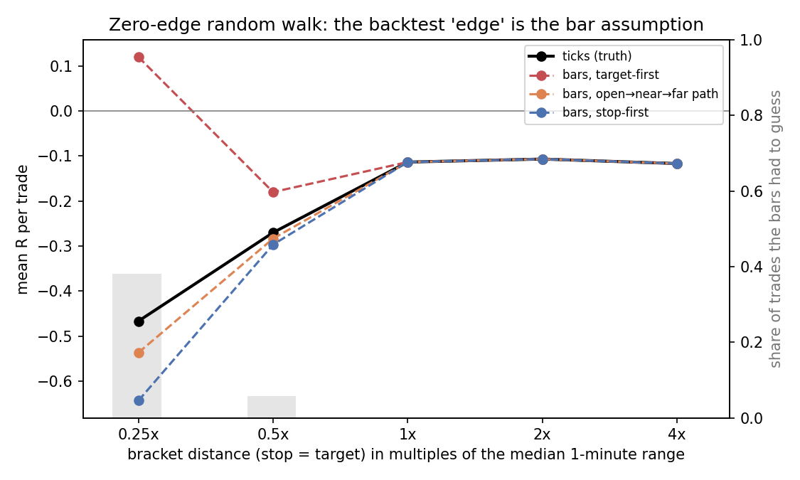
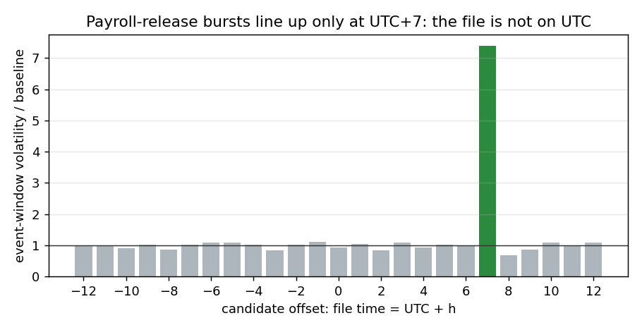

# dukafetch: free tick data, decoded correctly, and a test for whether your backtest is lying

[](https://github.com/Tolbert-Okoth/dukascopy-tools/actions/workflows/tests.yml)


Dukascopy publishes years of **free tick and 1-minute bid/ask data** for FX, metals, indices and crypto. Getting it is easy; getting it *right* is not. `dukafetch` downloads it politely and resumably, decodes it with verified formats, and protects you from four silent errors I hit in practice:
- **padding candles** (fake flat bars);
- **wrong price divisors**;
- **files on the wrong clock**;
- **bar backtests that invent edge**.

## The headline: a backtest can turn a losing strategy into a winning one



I simulated **ticks with no edge at all**: a driftless random walk with a $0.10 spread. The trades were long entries at 600 random minutes with a symmetric stop and target. Each trade was resolved on 1-minute bars under three common assumptions, and on the ticks themselves:

| Bracket distance vs median 1-min range | Bars had to guess | Ticks (truth) | Bars, target-first | Bars, open→near→far | Bars, stop-first |
|---|---|---|---|---|---|
| 0.25× | **38 %** of trades | **−0.47 R** | **+0.12 R** | −0.54 R | −0.64 R |
| 0.5× | 6 % | −0.27 R | −0.18 R | −0.28 R | −0.30 R |
| ≥ 1× | 0 % | −0.11 R | −0.11 R | −0.11 R | −0.11 R |

With tight brackets, an "optimistic" bar backtest reports a **profitable** strategy. In reality the strategy loses almost half a risk unit per trade. Even the popular "neutral" path rule is wrong, just in the other direction. The rule of thumb that follows:

> **If your stop or target fits inside a typical bar, your bar backtest is guessing.** Re-run it on ticks, or measure how many trades were ambiguous with `ambiguity_report`.

I learned this the expensive way: a scalping strategy whose bar-backtest edge was entirely this artefact. The synthetic experiment above reproduces the effect with no proprietary data: `python examples/bar_vs_tick.py`.

## Three data traps

**1. Padding candles.** Dukascopy's daily 1-minute files contain a record for *every* minute, including hours when the market is closed. Those minutes are flat, zero-volume copies of the last price. In one real SMI index file I checked, **604 of 1,440 candles were padding**. Left in, they deflate volatility, inflate the number of "quiet" bars and corrupt session statistics. `decode_candles` drops them by default.

**2. Price divisors.** Prices are stored as integers. XAUUSD and USDJPY divide by 1,000, EURUSD by 100,000 and BTCUSD by 10. A wrong divisor gives prices off by 10–1,000×. That survives any return-based check and breaks every cost, stop and level. `sanity_check(prices, expected=...)` fails loudly instead.

**3. The wrong clock.** Vendor files are often stamped in "server time", not UTC. Documentation is sometimes wrong too: one of my own data files turned out to be on New York + 7 h when it was labelled UTC. Every session filter, news filter and time-of-day result built on it would have been shifted. `detect_clock_offset` lets the market tell you the clock. It aligns the volatility burst that follows scheduled releases (US payrolls, 08:30 New York, via `nfp_times_utc`) at every candidate offset and picks the one where the bursts line up.



```python
from dukafetch import detect_clock_offset, nfp_times_utc
best, table = detect_clock_offset(m1_close, nfp_times_utc("2022-01-01", "2024-12-31"))   # best = +7 -> file time = UTC + 7 h
```
The detector assumes a fixed offset. For a server clock that follows DST (e.g. UTC+2 winter / UTC+3 summer), run it separately on summer and winter months. Synthetic demo: `python examples/clock_check.py`.

The record formats were verified against real files: BTCUSD ticks near $106.8k on 2025-07-01, and SMI candles near 8,370 in January 2019. Note the candle field order: **open, close, low, high**, not OHLC.

## Install

```bash
pip install "dukafetch[plot] @ git+https://github.com/Tolbert-Okoth/dukascopy-tools"
```

## Use

```bash
dukafetch candles XAUUSD 2025-01-01 2025-02-01 --sides BID ASK --out data      # resumable; Ctrl-C safe
dukafetch ticks   EURUSD 2025-01-06 2025-01-07 --out data
dukafetch export  XAUUSD --kind candles --side BID --out data --csv xauusd_m1.csv --expect 2650
```

```python
from dukafetch import download_ticks, load_ticks, ticks_to_bars, resolve_on_bars, resolve_on_ticks

download_ticks("XAUUSD", "2025-01-06", "2025-01-07", out_dir="data")
ticks = load_ticks("data", "XAUUSD")                      # UTC index; bid, ask, volumes
bars = ticks_to_bars(ticks, "1min")

t = bars.index[100]; entry = ticks.ask.asof(t)
print(resolve_on_bars(bars, t, +1, entry, entry - 0.5, entry + 0.5, rule="optimistic"))  # (R, exit time, ambiguous?)
print(resolve_on_ticks(ticks, t, +1, entry, entry - 0.5, entry + 0.5))                   # (R, exit time)
```

## How the downloader behaves

- **Resumable and atomic:** each file is written to a unique `.part` file and then renamed. Re-runs skip finished files. Hours and days with no data are stored as 0-byte files, so they aren't requested again.
- **Polite:** at most 3 workers. The request rate adapts, halving on `429`/`5xx` and creeping back up slowly, and retries back off. The tests use a fake session to cover throttling, 404s and resume.
- **Newest first:** recent data, usually what you need first, arrives first.
- **Raw is immutable:** decoding never modifies the downloaded files.

## Tests

```bash
python -m unittest discover -s tests -v
```

The 13 tests cover:
- a tick and candle round-trip through the binary formats;
- dropping padding candles;
- the divisor guard;
- the URL's zero-based month;
- resume, 404 and throttle handling;
- bracket resolution on bars vs ticks, for long and short trades;
- payroll release times across DST, and clock-offset detection on UTC, UTC+2, UTC+7 and tz-aware files.

## Notes

- Dukascopy data is free to download, but **check their terms before redistributing it**. This repository ships no market data.
- Times are UTC. Dukascopy bars are labelled by their **open** time.

MIT licensed.
